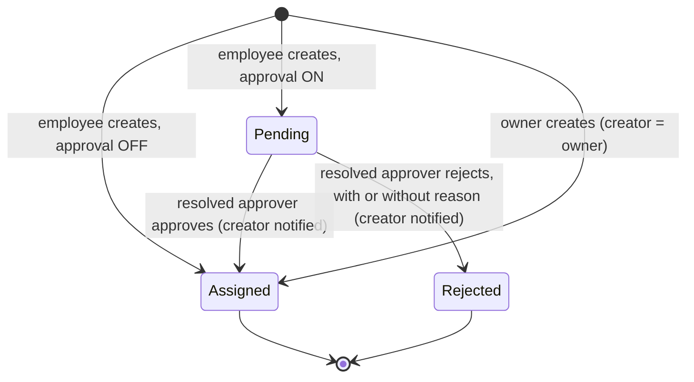

# Approval routing

Companion to `SPEC.md`. Routing rules and notification recipients only; the capability contracts are in SPEC.md. Decisions D11–D14 (see `.decision-log.md`) govern the cases below.

## Resolved approver (computed at action time)

Given requester **R** and the tree as it stands at the moment of the action:

1. **R at the top of the tree** — an admin; admins can never hold a manager, so this is checked first, before any walk, whatever the admin count. The request stays pending and R decides it themself (D11). No submission notification is emitted (CAP-4); the other admins keep the override right but are not notified. Nothing is auto-approved.
2. Otherwise start at R's reporting manager. A candidate must be an **active** member who is neither R (the requester) nor the **actor** of the filing — the person who files a request never decides it (D14; on-behalf applies to leave in this epic). If the candidate is inactive, removed, R, or the actor, climb: go to that member's reporting manager.
3. **Unassigned-ness only defines the up-step, never disqualifies an approver.** An active member whose own `manager_id` is null is a perfectly valid approver — and when the walk reaches such a member as an eligible candidate, that member is the **single resolved approver**. When the walk must step **up from** an unassigned member, its "up" step is the **fallback set** — all active admins (D12): they are the resolved approver set, any of them may decide — except the actor of an on-behalf filing, who is excluded from their own filing's set (D14) — and notifications reach all of them. In the fallback set the **first decision wins and closes the request for every member of the set**; the acting member is recorded in the audit row. This set-fallback is a deliberate transitional bridge: once real managers are assigned, requests resolve to a single approver.
4. **Bound and failure:** the walk takes at most depth-cap + 1 steps with a visited set. A revisit means a corrupt tree; a walk that exhausts without a candidate means an ownerless company. Both refuse the transition with a plain-English error — these are legitimate, stated cases, not only corruption.

Notes:

- The resolved approver is **never stored** on the request. A pending request's queue membership and decision rights are recomputed from the tree on every read and action — so reassignments, deactivations and demotions take effect instantly with nothing to migrate. The "resolved approver changed" notices (below) are therefore emitted from the **tree-change transaction** that touches pending requests, not detected lazily.
- The admin override is separate: any active admin may act on any request in the company regardless of the walk's outcome.
- **On-behalf carve-outs (D14):** a manager's on-behalf leave filing walks from the subject employee and skips the actor; it therefore resolves to the nearest eligible manager **above the subject** — the actor's own manager only when the actor is the subject's direct manager — or to the fallback set. The admin's own on-behalf filing keeps today's behaviour — created decided, by the admin — unchanged by this epic. On-behalf applies to leave in this epic; job on-behalf rides the future "managers creating jobs" story.
- **Audit snapshot:** the submission audit event records the resolved approver set at submission time; routing itself stays derived at action time. This answers "who should have decided this?" after a mid-flight reorg without reintroducing the static-binding anti-pattern.
- **Atomicity:** the walk and the decision write run in one transaction holding the same advisory locks (AD-5 keys) as manager assignment and removal — a concurrent reassignment can never land between the walk and the write.

## Notification routing

| Event | Today | With hierarchy |
|---|---|---|
| `leave.applied` / `leave.applied_on_behalf` | every active company admin | the resolved approver set: the single resolved approver, or all active admins on fallback (D12). The actor never self-notifies: a manager's on-behalf filing routes up (D14), and an admin's self-filed request notifies no one (D11) |
| `job.submitted` | every active company admin except the creator | the resolved approver set (the walk never returns the creator) |
| `leave.pending_reminder` and attendance reminders that today name admins | admins | the resolved approver set |
| `leave.approved` / `rejected` / `owner_revoked` / `employee_cancelled` / `checkin_auto_cancel` | the requester | unchanged |
| `job.approved` / `rejected` / `edited` / `cancelled` | the creator | unchanged |
| Resolved approver set changed while request pending | — | emitted from the tree-change transaction, **per affected pending request, to the set difference**: "now awaiting your approval" only to members newly in the resolved set; "no longer yours to approve" only to members that left it (skipping members no longer active). Admin activation/deactivation counts as a tree change for fallback-routed requests |
| Walk cannot resolve (no active admin) | — | submission and reminder notifications are suppressed with a logged warning; the request stays pending and surface as an approval-time refusal (never auto-approved) |

- Dedupe keys keep the existing recipient-aware shape `<tenantId>:<eventType>:<recipientId>:<entityId>`. Recipients are computed before insert, so a recipient never receives two rows for one event — an admin who is also the single resolved approver gets one entry, not two.
- Admins outside the resolved set receive no submission notifications (D7 — a deliberate narrowing of today's all-admins fan-out). It rides the `fenzit-be` deploy; old clients render notifications from the database, so no client change is needed.
- Notification inserts remain post-commit best-effort (established house pattern).

## Edge cases

- **Manager removed:** their subtree re-parents to the removed member's manager in the same transaction as the removal; if the removed member was unassigned, their reports become unassigned too (the fallback set covers routing). A removal that would leave no active admin is refused. The removed member's **own** pending requests follow today's removal semantics (the existing cancellation flow, cause `removal`) — unchanged by this epic.
- **Manager deactivated:** the walk skips inactive members; responsibility moves up the chain immediately.
- **Manager demoted or role-changed while people still report to them:** rights are tree-derived (D13) — they remain a manager. No re-parenting happens on role changes (D9).
- **Requester moves branch:** pending requests appear in the new branch's queue at the next action or read; no data migration.
- **Pending-job edits:** owner-only in this epic (epic-22 CAP-5); the manager decides but does not edit.
- **Approvals are per-day for leave:** subtree scoping filters at request level (`employee_id` → tree lookup); the day-state transition machinery (`attendance_lock_employee`, overlap partial index) is untouched.

## Job state diagram (unchanged)

While `Pending`, the owner may still edit fields (epic-22 CAP-5) and then approve or reject. Only `Pending` accepts a decision or an owner edit; a second decision returns a conflict (established epic-22 behaviour: a lost-response retry of the winning decision reconciles via the conflict).
