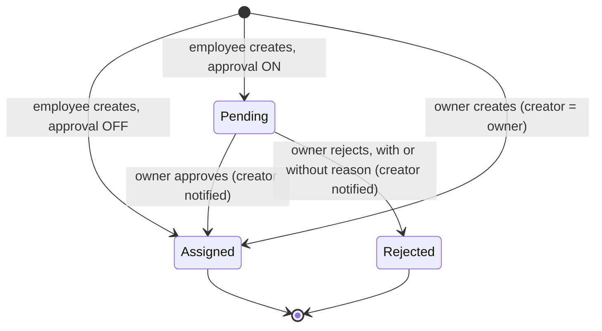

# Job approval states

Companion to `SPEC.md`. Diagram only; the rules are in SPEC.md.

| State | Counted as assigned | Shown as active work | Who sees it |
|---|---|---|---|
| Pending | No | No (shown as Pending owner approval) | Creator, owner |
| Assigned | Yes | Yes | Creator, owner, technician as assignee |
| Rejected | No | No | Creator, owner |

While `Pending`, the owner may edit fields and then approve or reject. Only `Pending` accepts a decision or an owner edit. A second decision on a job that has left `Pending` returns a conflict (CAP-5).
