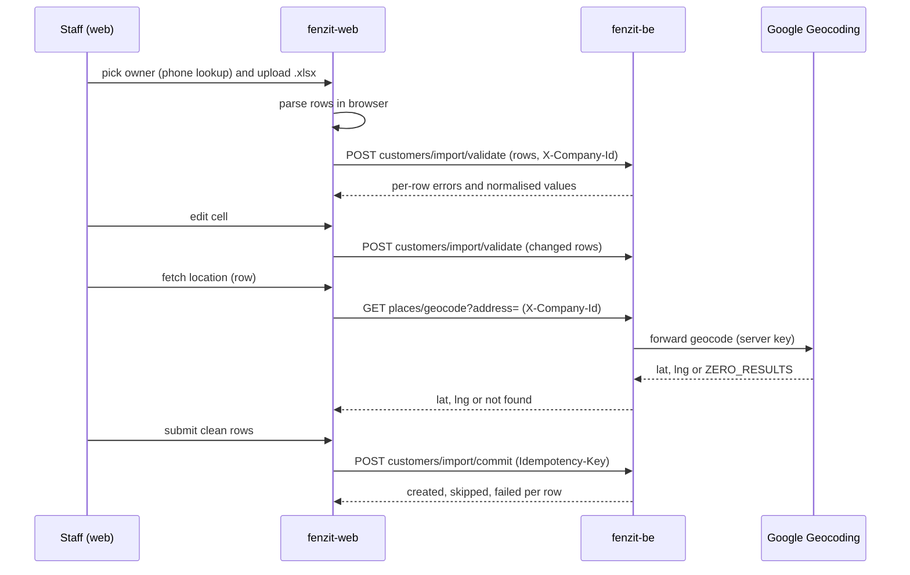

# Import flow and contracts (staff only)

## Layer decision

| Concern | Layer | Why |
|---|---|---|
| Excel read into rows | FE (client) | No multipart upload exists in fenzit-be. Avoids a new upload path. |
| Phone normalisation, required fields, lat/lng range, duplicate check, tenant scope | BE | Server is the source of truth. Every row is re-checked. |
| Forward geocode (address to lat/lng) | BE | Google key stays server-side. Reuses the Legacy Geocoding client already in `places`. |
| Commit (insert customers, audit) | BE | Single owner of tenant scope and duplicate rules. |
| `created_via` value `bulk_import` | DB | CHECK constraint must allow the new value. |
| Preview UI, cell editing, per-row fetch state | FE | Presentation only. |

Backend ships first. Each change is additive.

## Sequence

## Endpoint sketch (not final)

All three: `user.manage` guard, `X-Company-Id` required, staff-only.

- `POST /customers/import/validate`: JSON body, array of rows. Stateless. Returns each row with normalised fields and errors.
- `GET /places/geocode?address=&city=&state=&pincode=`: forward geocode. Server joins the filled parts with commas and adds India as the country filter. Separate rate budget from reverse. Returns lat/lng or not-found.
- `POST /customers/import/commit`: JSON body, array of rows, `Idempotency-Key` header. Returns created, updated and failed per row. New rows insert with `created_via = 'bulk_import'`. A phone match updates the existing customer, only in fields the import sets.

## Known facts from code

- `customers` has no `state` column today. Story 2 adds it (nullable).
- `customers` has unique `(tenant_id, country_code, phone_number)`.
- `POST /customers` is single-row and returns 409 on a duplicate phone.
- Reverse geocode is rate-limited at 10 per 60 seconds per tenant key, held in memory per instance.
- The `platform_admin` role includes the company permissions, so `customer.write` passes when `X-Company-Id` is set.
- Platform-audit interceptor writes audit rows only for `:userId` routes.

## Sheet format (shown to staff in the upload screen)

The screen offers a **sample file** (.xlsx or .csv) built in the browser from the column table below: header row plus one example row. Built in FE only; the backend does not change.

One header row. One customer per row. Column names are matched case-insensitively. Extra columns are ignored.

| Column | Required | Rule |
|---|---|---|
| `name` | yes | Customer full name, up to 120 characters. |
| `address` | yes | Street address, up to 255 characters. Used for "fetch location". |
| `phone` | yes | Mobile number, 6 to 15 digits, no spaces needed. Dial code optional. |
| `latitude` | no | Decimal degrees, -90 to 90. Needs `longitude`. |
| `longitude` | no | Decimal degrees, -180 to 180. Needs `latitude`. |
| `city` | no | Up to 100 characters. |
| `state` | no | State or union territory, up to 100 characters. Used with address for "fetch location". |
| `pincode` | no | 6-digit Indian PIN code. |
| `address_details` | no | Flat, building, floor or landmark. Up to 255 characters. |

Rules shown to staff:
- Fetch location uses every filled part (address, city, state, pincode). Filling city and state improves the match.
- If a phone has no dial code, the country picked for the sheet applies. A dial code in the row wins.
- Blank latitude and longitude are fine. The row is saved and flagged "no map pin".
- A phone that already exists for this company updates that customer. Only the cells you fill in change.
- Limits: 500 rows, 5 MB, `.xlsx` or `.csv`.
